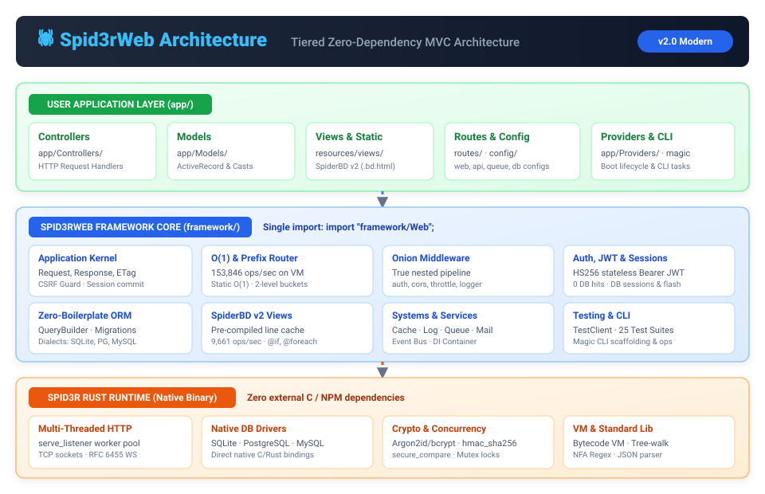
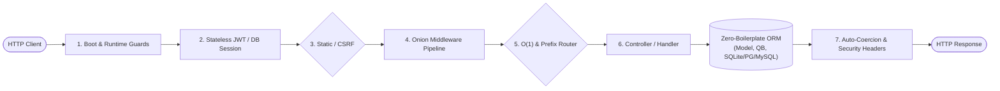

# Spid3rWeb 🕸️

A modern, lightweight, high-performance **MVC web framework** (`v1.1.0`) for the [Spid3r language](https://github.com/needyamin/spid3r) (`v1.1.1+`). Zero external dependencies — O(1) indexed router, Onion middleware pipeline, zero-boilerplate ORM, SpiderBD v2 template engine, dynamic migrations, JWT & DB session auth (with 2-layer CSRF), Argon2id/Bcrypt hashing, cache, queues, DI container, events, REST resources, `TestClient`, and Magic CLI all run natively on Spid3r's bytecode VM, tree-walk interpreter, and LLVM 23 AOT compiler.

📖 **Docs:** [Developer Guide](docs/developer-docs.html) · [Architecture](docs/ARCHITECTURE.md) · [Security Guide](docs/SECURITY.md) · [Driver Support Matrix](docs/DRIVERS.md) · [Deployment Guide](docs/DEPLOY.md) · [Upstream Requests](docs/UPSTREAM_REQUESTS.md) · **Visual Diagrams:** [docs/diagrams/](docs/diagrams/) · **API Reference:** run `spid3r magic docs` (`docs/build/api.html`) · **Worked Example:** [examples/task-api/main.matrix](examples/task-api/main.matrix)

---

## 🏛️ Architecture at a Glance

Spid3rWeb is structured as a zero-dependency 3-tier MVC framework (`app/`, `bootstrap/`, `framework/`) running directly on top of the native Spid3r Rust runtime:

<p align="center">
  
</p>

### ⚡ Request Lifecycle & Onion Pipeline

Every request flows through production readiness guards, stateless JWT / DB session auth, 2-layer CSRF, true Onion middleware, and an O(1) + prefix-indexed router:



> 📊 **Technical schematics:** [Request Lifecycle](docs/diagrams/request-lifecycle.svg) · [Onion Middleware](docs/diagrams/onion-middleware.svg) · [Router Architecture](docs/diagrams/router-architecture.svg) · [MVC ORM Flow](docs/diagrams/mvc-orm-flow.svg) · [Auth & JWT Flow](docs/diagrams/auth-flow.svg) · [Fluent TestClient](docs/diagrams/testclient-flow.svg) in **[docs/diagrams/](docs/diagrams/)**.

---

## Quick Start

**One-click install (Linux / macOS / Windows — Git Bash):**

```bash
sh install.sh            # installs pinned Spid3r v1.1.1 (SHA-256 checked), sets .env 0600 + APP_KEY, migrates DB
sh install.sh --serve    # ...and starts the dev server immediately
```

> **Windows + OneDrive tip:** Keep dev checkouts outside OneDrive-synced folders (or set `SPID3R_STATE_DIR=%LOCALAPPDATA%\Spid3rWeb` / `SPID3R_DB_PATH` outside synced folders) to avoid SQLite WAL/SHM lock conflicts. Run `spid3r magic doctor` to check environment health.

**Manual steps** (if Spid3r `v1.1.1+` is already installed):

```bash
cp .env.example .env
spid3r magic key:generate   # populate 256-bit APP_KEY
spid3r magic migrate        # auto-sync & run pending migrations
spid3r magic db:seed        # optional — runs registered seeders
spid3r magic doctor         # inspect runtime version, perms, ini config & DB health
spid3r magic serve          # start server → http://127.0.0.1:8000 (health: /health)
```

---

## Flavor of the Framework (Single-Import Express/Fastify DX)

Build complete apps or REST APIs with a single `import "framework/Web";`:

```spid3r
import "framework/Web";

let app = web();

// Define a model repository in 1 line with casts, hidden fields & fillable guard
let Post = model("posts", {
    "fillable": ["title", "body", "published", "meta"],
    "hidden": ["internal_token"],
    "casts": {"published": "bool", "meta": "json"}
});

// Return maps/lists directly -> auto-serialized as 200 JSON
app.get("/api/posts", req => {
    return Post.latest().paginate(req.page(), req.per_page());
});

// Automatic 404 on missing record via find_or_fail()
app.get("/api/posts/:id", req => {
    return Post.find_or_fail(req.int("id")).to_map();
}).name("posts.show");

// Express-style (req, res) handler + 1-line validate_or_fail() (422 on error)
app.post("/api/posts", (req, res) => {
    let data = req.validate_or_fail({
        "title": "required|min:3|max:200",
        "body":  "required|min:10"
    });
    let post = Post.create(data);
    return res.status(201).json(post.to_map());
}).middleware(["auth", "throttle:60,60"]);

app.listen(8000);
```

Run the standalone Task API example with zero setup:

```bash
SPID3R_PATH=. SPID3R_DB_DRIVER=sqlite spid3r run examples/task-api/main.matrix
# Or compile to a standalone native AOT binary:
SPID3R_PATH=. spid3r build --release examples/task-api/main.matrix -o dist/task-api && ./dist/task-api
```

---

## Magic CLI

```bash
# Serve, Build & Docs
spid3r magic serve                    # HTTP/HTTPS server (--host H, --port N, --watch, --tls --cert C --key K)
spid3r magic build --release --bundle -o dist/spid3rweb   # Standalone LLVM-23 AOT binary + assets
spid3r magic build --bytecode-only -o dist/server.matrixc # Compiled bytecode module (`spid3r exec`)
spid3r magic docs                     # Generate HTML API reference (`docs/build/api.html`; `--json` for JSON)
spid3r magic bench [--gate]           # Run framework micro-benchmarks and perf gate

# Verification, Health & Hygiene
spid3r magic test                     # Run all 25 automated test suites (`--filter`, `--coverage`, `--differential`, `--db=all`)
spid3r magic doctor [--fix] [--strict] # Audit runtime version, permissions, APP_KEY, ini + config schema & DB
spid3r magic config:check             # Validate all 13 config/*.matrix namespaces & value bounds
spid3r magic lint                     # Run `spid3r config validate` + `spid3r check` across project
spid3r magic fmt [--check]            # Format or verify formatting with `spid3r fmt`
spid3r magic route:list               # List registered routes and names

# Database, Cache, Queue & Storage
spid3r magic migrate                  # Run pending migrations (`--pretend`, `--step`, checksums, up/down functions)
spid3r magic migrate:fresh            # Wipe database tables and re-run all migrations (`--pretend`, `--step`)
spid3r magic migrate:reset            # Roll back all executed migration batches
spid3r magic migrate:sync             # Force-rebuild storage/framework/migrations.matrix
spid3r magic migrate:rollback         # Roll back last migration batch
spid3r magic migrate:status           # Show migration status & checksum drift
spid3r magic migrate:rename-legacy    # Convert NNN_* filenames to Laravel timestamps
spid3r magic db:wipe                  # Drop all database tables cleanly
spid3r magic db:seed                  # Run database seeders
spid3r magic db:backup                # Online SQLite backup snapshot under storage/backups/
spid3r magic db:vacuum                # Checkpoint SQLite WAL / run VACUUM
spid3r magic storage:link             # Symlink/junction public/storage -> storage/app/public
spid3r magic storage:prune            # Prune old logs and stale temp uploads
spid3r magic cache:gc                 # Garbage-collect expired cache entries
spid3r magic cache:clear              # Flush application cache store
spid3r magic queue:work               # Drain queued jobs (`--once`, `--daemon`, `--sleep=MS`)
spid3r magic key:generate             # Generate a 256-bit APP_KEY atomically in .env

# Generators
spid3r magic make:controller <Name>   # Scaffold MVC controller
spid3r magic make:model <Name> [-m]   # Scaffold model repository (+ optional migration)
spid3r magic make:middleware <Name>   # Scaffold Onion HTTP middleware
spid3r magic make:provider <Name>     # Scaffold ServiceProvider
spid3r magic make:request <Name>      # Scaffold validation request class
spid3r magic make:resource <Name>     # Scaffold REST resource transformer
spid3r magic make:command <Name>      # Scaffold Magic CLI console command
spid3r magic make:seeder <Name>       # Scaffold database seeder class
spid3r magic make:test <name>         # Scaffold TestClient test suite
spid3r magic make:migration <name>    # Scaffold timestamped migration (`--fn` for up/down functions)
```

---

## What's in the Box

| Area | Highlights |
|---|---|
| **Single-import barrel** | `import "framework/Web";` exports `web()`, `router()`, `model()`, `route()`, `abort()`, `send_stream()`, `send_sse()`, `db()`, `schema()`, `cache()`, `auth()`, `jwt()`, `hash()`, `log()`, `queue()`, `mail()`, `storage()`, `events()`, `config()`, `views()`, `test_client()` |
| **Hardened HTTP kernel** | `Application` + `StaticFiles` + `Csrf` + `CookieJar` + `Server`: streaming static assets, segment traversal guard, randomized uploads with size/count/MIME/extension checks, trusted reverse-proxy support, configurable CSP & auto-HSTS, `drain_ms` shutdown window, `/health` probe |
| **O(1) & Prefix-Indexed Router** | O(1) hash lookup for static routes, 2-level segment + literal-prefix buckets for `:param`/`{param}`, `*wildcard` catch-alls, `Route.resource`, `app.mount()`, reverse routing via `route(name, params)` |
| **True Onion Middleware** | `(req, next) => next(req)` closures & classes: `auth`, `guest`, `cors`, `logger`, `etag`, `request_id`, `throttle:N,S` |
| **Zero-Boilerplate ORM & Drivers** | `Driver` interface across SQLite (`WAL`, `synchronous=NORMAL`, `foreign_keys=ON`, `busy_timeout=5000`), PostgreSQL, MySQL 8, MariaDB; `ConnectionPool` + 1-shot reconnect; `model()` + `Model` casts/hidden/dirty tracking |
| **Auth, Argon2id & JWT** | **Argon2id** default + Bcrypt + `needs_rehash()` upgrade on login; DB-backed CSPRNG sessions + stateless HS256 `Jwt` (`secure_compare`), 2-layer CSRF, `CookieJar` |
| **SpiderBD v2 Views** | Compiled template cache with `file_mtime` invalidation, `@if`/`@elif`/`@else`, `@foreach` `loop` metadata, `@csrf`, `@method`, `views().share()` |
| **Testing (`TestClient`)** | Fluent integration client (`acting_as()`, `post_json()`, `assert_json_path()`, stream draining), 25 auto-discovered suites, `--coverage`, and 3-engine `--differential` runner |

---

## Performance & Deployment

See [benchmarks/RESULTS.md](benchmarks/RESULTS.md) and [docs/DEPLOY.md](docs/DEPLOY.md) for deployment topologies (native LLVM AOT binaries, Docker + unprivileged `USER spid3r`, Nginx/Caddy reverse proxies) and benchmarks.

```bash
SPID3R_DB_DRIVER=sqlite spid3r magic test                 # 25/25 suites (bytecode VM default)
SPID3R_DB_DRIVER=sqlite spid3r magic test --differential  # tree == vm == compiled exec parity
SPID3R_DB_DRIVER=sqlite spid3r magic bench --gate         # verify performance floors
```

## License

GPL-3.0-or-later. Built with ❤️ for the Spid3r ecosystem.
