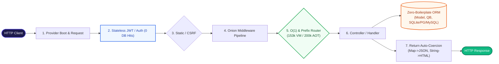

# Spid3rWeb 🕸️

A modern, lightweight, high-performance **MVC web framework** for the [Spid3r language](https://github.com/needyamin/spid3r). Zero external dependencies — O(1) indexed router, Onion middleware pipeline, zero-boilerplate ORM, SpiderBD v2 template engine, migrations, JWT & session auth, flash sessions, cache, queues, DI container, events, REST resources, `TestClient`, and CLI all run natively on Spid3r's interpreter and bytecode VM.

📖 **Architecture & roadmap:** [docs/ARCHITECTURE.md](docs/ARCHITECTURE.md) · **Visual Diagrams:** [docs/diagrams/](docs/diagrams/) · **Master Plan:** [plan.txt](plan.txt) · **Reference docs:** [docs/developer-docs.html](docs/developer-docs.html) · **Worked example:** [examples/task-api/main.matrix](examples/task-api/main.matrix)

---

## 🏛️ Architecture at a Glance

Spid3rWeb is structured as a zero-dependency 3-tier MVC framework running directly on top of the native Spid3r Rust runtime:

<p align="center">
  
</p>

### ⚡ Request Lifecycle & Onion Pipeline

Every request flows through an idempotent boot, stateless JWT validation, true Onion middleware, and an O(1) + prefix-indexed router:



> 📊 **Explore all technical diagrams:** [Request Lifecycle](docs/diagrams/request-lifecycle.svg) · [Onion Middleware](docs/diagrams/onion-middleware.svg) · [Router Architecture](docs/diagrams/router-architecture.svg) · [MVC ORM Flow](docs/diagrams/mvc-orm-flow.svg) · [Auth & JWT Flow](docs/diagrams/auth-flow.svg) · [Fluent TestClient](docs/diagrams/testclient-flow.svg) in **[docs/diagrams/](docs/diagrams/)**.

---

## Quick Start

**One-click install (Linux / macOS / Windows — Git Bash):**

```bash
sh install.sh            # installs the Spid3r language if missing, then sets up the project
sh install.sh --serve    # ...and starts the dev server immediately
```

**Manual steps** (if Spid3r is already installed):

```bash
spid3r magic migrate     # create schema (migrations auto-discovered)
spid3r magic db:seed     # optional — no-op until you add seeders
spid3r magic serve       # start server → http://localhost:8000
```

## Flavor of the Framework (Single-Import Express/Fastify DX)

Build complete apps or REST APIs with a single `import "framework/Web";`:

```spid3r
import "framework/Web";

let app = web();

// Define a model repository in 1 line with casts, hidden fields & fillable guard
let Post = model("posts", {
    "fillable": ["title", "body", "published", "meta"],
    "hidden": ["internal_token"],
    "casts": {"published": "bool", "meta": "json"}
});

// Return maps/lists directly -> auto-serialized as 200 JSON
app.get("/api/posts", req => {
    return Post.latest().paginate(req.page(), req.per_page());
});

// Automatic 404 on missing record via find_or_fail()
app.get("/api/posts/:id", req => {
    return Post.find_or_fail(req.int("id")).to_map();
}).name("posts.show");

// Express-style (req, res) handler + 1-line validate_or_fail() (422 on error)
app.post("/api/posts", (req, res) => {
    let data = req.validate_or_fail({
        "title": "required|min:3|max:200",
        "body":  "required|min:10"
    });
    let post = Post.create(data);
    return res.status(201).json(post.to_map());
}).middleware(["auth", "throttle:60,60"]);

app.listen(8000);
```

Run the self-contained full-stack Task API example with zero setup (Bytecode VM is default in Spid3r v1.1.1+):

```bash
SPID3R_PATH=. SPID3R_DB_DRIVER=sqlite spid3r run examples/task-api/main.matrix
# Or compile to a standalone native binary with LLVM 23 AOT:
SPID3R_PATH=. spid3r build --release examples/task-api/main.matrix -o task-api && ./task-api
```

## Magic CLI

```bash
spid3r magic serve                    # start HTTP/HTTPS server (--port N, --tls --cert C --key K)
spid3r magic build --release          # compile standalone LLVM-23 AOT native binary (-o dist/server, --bundle)
spid3r magic test                     # auto-discover and run all 17 test suites
spid3r magic route:list               # list registered routes and names
spid3r magic migrate                  # run pending migrations (auto-synced)
spid3r magic migrate:sync             # rebuild database/migrations/registry.matrix
spid3r magic migrate:rollback         # roll back the last batch
spid3r magic migrate:status           # show migration status
spid3r magic db:seed                  # seed the database
spid3r magic queue:work               # drain queued jobs (--once = 1 job, --daemon = graceful loop)
spid3r magic cache:clear              # flush the application cache store
spid3r magic key:generate             # generate a random 256-bit APP_KEY in .env
spid3r magic make:controller <Name>   # scaffold a modern MVC controller
spid3r magic make:model <Name> [-m]   # scaffold a zero-boilerplate model (+ optional migration)
spid3r magic make:middleware <Name>   # scaffold an Onion HTTP middleware class
spid3r magic make:provider <Name>     # scaffold a ServiceProvider class
spid3r magic make:test <name>         # scaffold a TestClient integration test suite
spid3r magic make:migration <name>    # scaffold a migration (auto-registered)
```

## What's in the Box

| Area | Highlights |
|---|---|
| **Single-import barrel** | `import "framework/Web";` exports `web()`, `router()`, `model()`, `route()`, `abort()`, `send_stream()`, `send_sse()`, `db()`, `schema()`, `cache()`, `auth()`, `jwt()`, `views()`, `test_client()` |
| **HTTP/HTTPS kernel** | HTTP/1.1 keep-alive server loop, native TLS (`app.listen_tls` / `magic serve --tls`), chunked streaming &amp; SSE (`res.stream` / `res.sse`), graceful shutdown (Ctrl+C), static asset ETag (`304 Not Modified`), method spoofing, auto-coercion, and auto project-root detection for AOT binaries |
| **O(1) & Prefix-Indexed Router** | **153,846 ops/sec** (VM) / **200,000 ops/sec** (AOT); O(1) hash lookup for static routes, 2-level segment + literal-prefix indexing for `:param` / `{param}` routes, `*wildcard` catch-alls, `app.mount(prefix, sub_router)`, reverse routing via `route(name, params)` |
| **True Onion Middleware** | `(req, next) => { let res = next(req); ... return res; }` closures and class middleware; built-ins: `auth`, `guest`, `cors`, `logger`, `etag`, `request_id`, `throttle:60,60` (with `X-RateLimit-*` headers) |
| **Zero-Boilerplate ORM** | `model("table", opts)` repository + `Model` base class, `casts` (`int`, `float`, `bool`, `string`, `json`), `hidden` column stripping, dirty tracking (`is_dirty()`), `find_or_fail()`, `first_or_fail()`, `update_or_create()`, batched eager loading (`load_has_many` / `load_belongs_to`), mutex-serialized transactions |
| **Validation & Coercion** | `req.validate_or_fail(rules)` returns coerced values or aborts with 422 JSON; rules include `required`, `nullable`, `int`, `float`, `bool`, `email`, `url`, `uuid`, `regex`, `between`, `in`, `unique:table,col`, `exists:table,col` |
| **Auth, JWT & Sessions** | DB-backed sessions + stateless HS256 `Jwt.sign` / `Jwt.verify` (`Bearer` tokens verified with zero DB hits), `req.session()` key-value store + one-time `flash()` messages, HMAC-signed cookies (`res.signed_cookie` / `req.signed_cookie`), multipart file uploads (`req.file()`, `req.store_file()`) |
| **SpiderBD v2 Views** | Pre-compiled template line cache with `file_mtime` invalidation, `@if(a == b and c >= 10)` / `@elif(...)` / `@else`, inline `@if(...)...@endif`, `@foreach` with `loop` metadata (`index`, `iteration`, `first`, `last`, `count`), `@csrf`, `@method('PUT')`, `views().share(k, v)` |
| **Testing (`TestClient`)** | Fluent integration client (`app.test_client().acting_as(user).post_json(...).assert_created().assert_json_path(...)`) |
| **Thread-Safe Core** | Mutex-guarded `MemoryCacheStore` (bounded eviction), O(1) locked streaming appends in `Log` (`file_open` + `file_lock`) and `Storage.append()`, plain-TCP SMTP in `Mail`, graceful `Queue.work_daemon()`, mutex-serialized `DatabaseManager.transaction()`, and `spid3r.ini.example` runtime guardrails |

## Performance

See [benchmarks/RESULTS.md](benchmarks/RESULTS.md) for methodology and full breakdown (measured 2026-11-20 on Spid3r `v1.1.1`):

- **Route matching (200 routes, `:param` capture):** **153,846 ops/sec** (VM default) / **200,000 ops/sec** (LLVM-23 AOT `--release`).
- **JSON round-trip:** **666,666 ops/sec** (VM) / **1,000,000 ops/sec** (AOT).
- **Query compilation:** **21,428 ops/sec** (VM) / **27,027 ops/sec** (AOT).
- **SpiderBD v2 template rendering:** **9,661 ops/sec** (VM) / **12,500 ops/sec** (AOT).

Serve in production (Bytecode VM is default in Spid3r v1.1.1+, or compile to a native AOT binary):

```bash
SPID3R_HOST=0.0.0.0 spid3r magic serve --port 8000
SPID3R_HOST=0.0.0.0 spid3r magic serve --port 8443 --tls --cert cert.pem --key key.pem
spid3r magic build --release --bundle -o dist/server.exe server.matrix && ./dist/server.exe --port 8000
```

## Testing

```bash
SPID3R_DB_DRIVER=sqlite spid3r magic test                 # 17/17 suites (bytecode VM default)
SPID3R_DB_DRIVER=sqlite spid3r magic test --engine=tree   # 17/17 suites (tree-walk oracle)
```

## License

GPL-3.0-or-later. Built with ❤️ for the Spid3r ecosystem.
