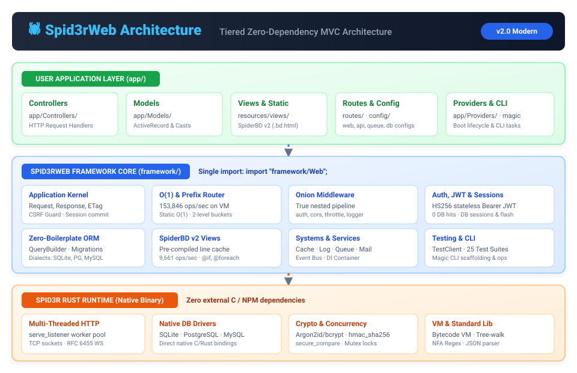
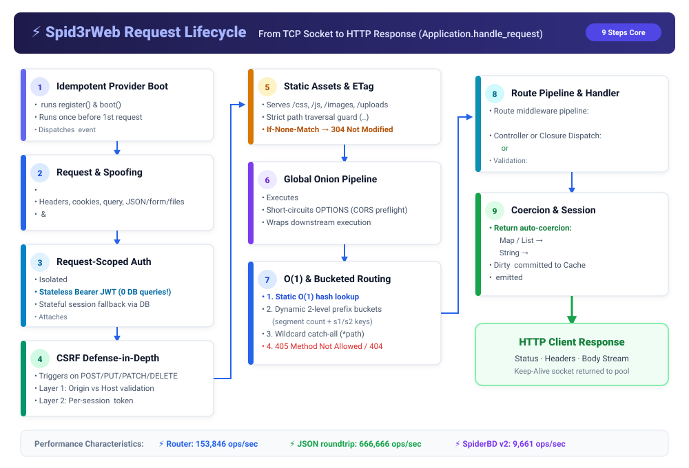
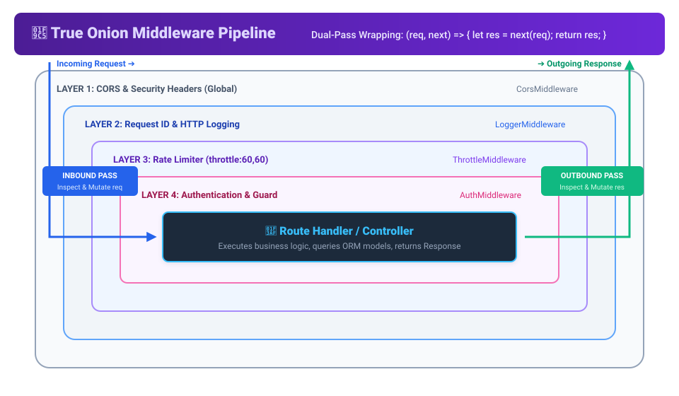
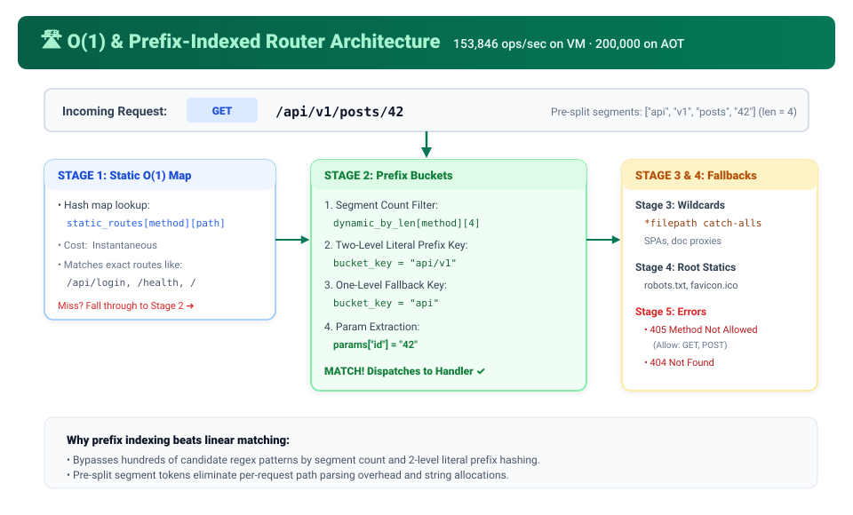
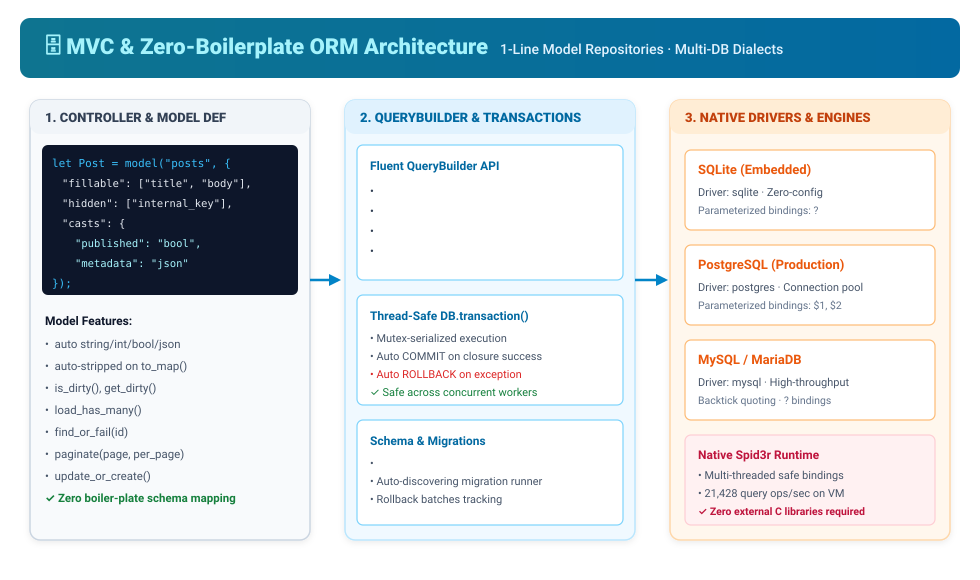
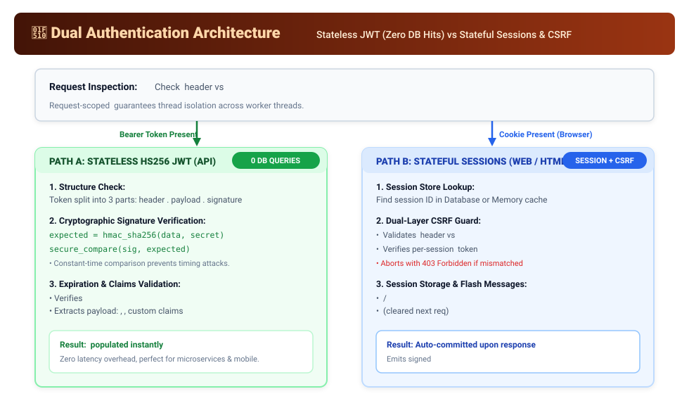
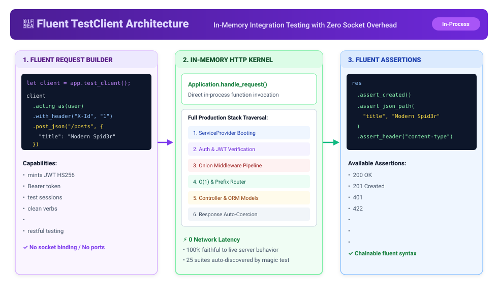

# Spid3rWeb — Architectural Diagrams 🎨

Seven technical schematics for the Spid3rWeb MVC framework. Every diagram ships as a standalone vector **SVG** (used on this page and in `developer-docs.html`) plus an editable **Mermaid** source (`.mmd`). All numbers match `benchmarks/RESULTS.md` and `developer-docs.html` — update both together if they change.

| # | Diagram | SVG | Mermaid | What it shows |
|---|---------|-----|---------|---------------|
| 1 | Architecture Overview | [architecture-overview.svg](architecture-overview.svg) | [.mmd](architecture-overview.mmd) | 3-tier separation: `app/` → `framework/` → Spid3r Rust runtime |
| 2 | Request Lifecycle | [request-lifecycle.svg](request-lifecycle.svg) | [.mmd](request-lifecycle.mmd) | 9 steps from TCP socket to HTTP response (`Application.handle_request`) |
| 3 | Onion Middleware | [onion-middleware.svg](onion-middleware.svg) | [.mmd](onion-middleware.mmd) | Dual-pass wrapping: `(req, next) => next(req)` |
| 4 | O(1) & Prefix Router | [router-architecture.svg](router-architecture.svg) | [.mmd](router-architecture.mmd) | Static hash → prefix buckets → wildcards · 153,846 ops/s VM / 200k AOT |
| 5 | MVC & ORM Flow | [mvc-orm-flow.svg](mvc-orm-flow.svg) | [.mmd](mvc-orm-flow.mmd) | 1-line models, auto-casts, QueryBuilder, transactions, native drivers |
| 6 | Dual Authentication | [auth-flow.svg](auth-flow.svg) | [.mmd](auth-flow.mmd) | Stateless JWT (0 DB queries) vs session cookies + 2-layer CSRF |
| 7 | Fluent TestClient | [testclient-flow.svg](testclient-flow.svg) | [.mmd](testclient-flow.mmd) | In-memory testing: `acting_as()`, kernel traversal, JSON assertions |

## Preview

| | |
|---|---|
|  |  |
|  |  |
|  |  |
|  | |

## Editing a diagram

1. Change the `.mmd` source (paste it into the [Mermaid Live Editor](https://mermaid.live) for a quick preview).
2. Re-export the SVG so it stays in sync with the source:

   ```bash
   npx @mermaid-js/mermaid-cli -i <name>.mmd -o <name>.svg -b white
   ```

3. Keep labels short — long strings wrap poorly and break layout at small sizes.

> **Note:** SVGs must contain only SVG elements inside `<text>` (use `<tspan>`, never HTML tags like `<code>`/`<strong>` — browsers silently drop them when the SVG is embedded via ``).
