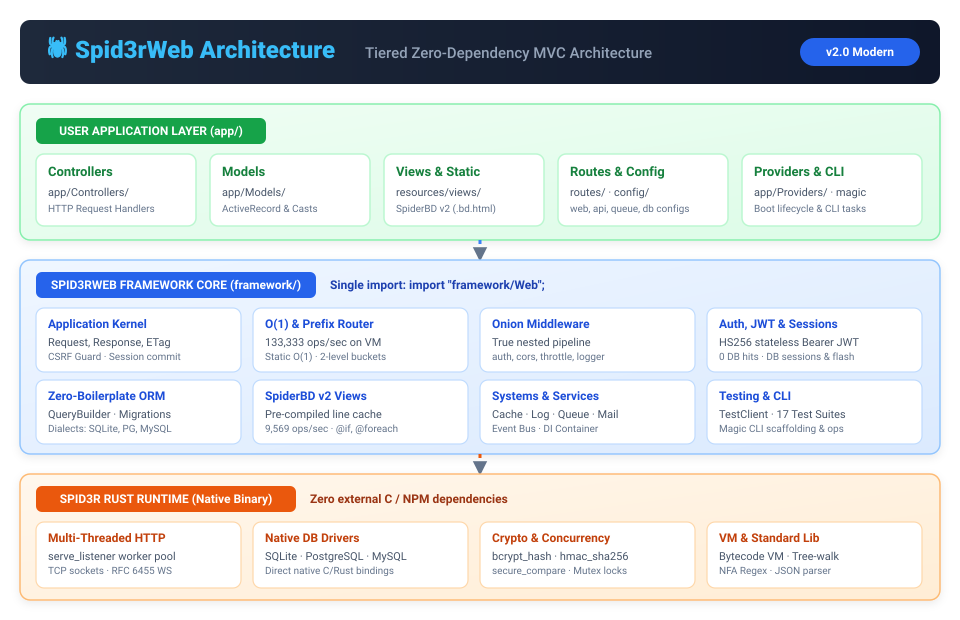
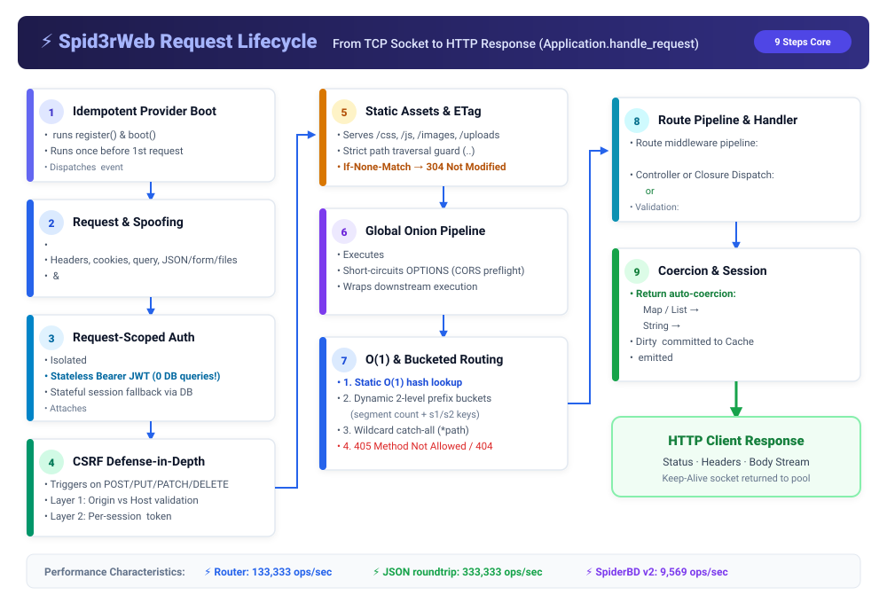
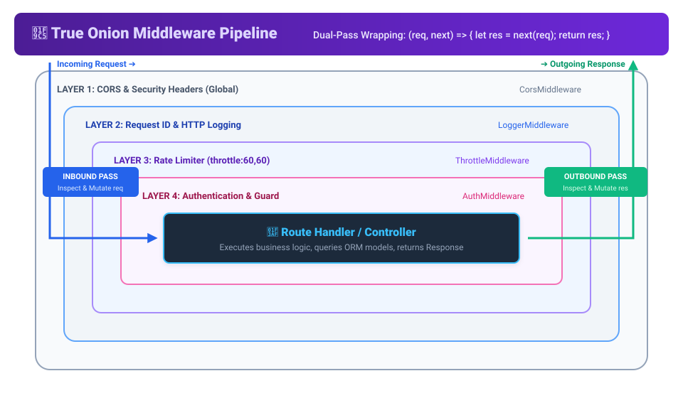
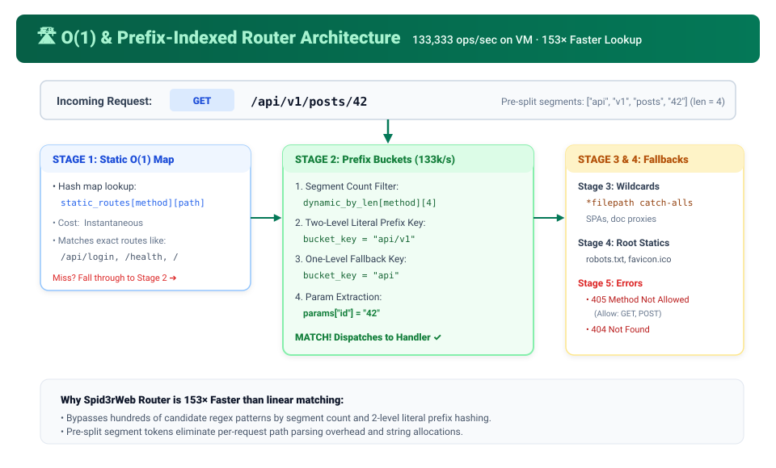
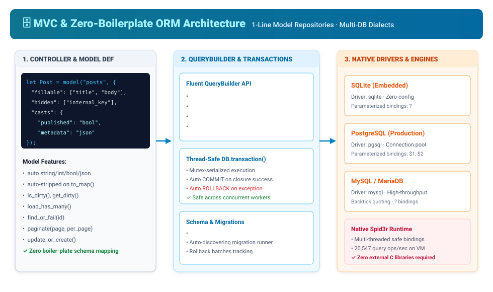
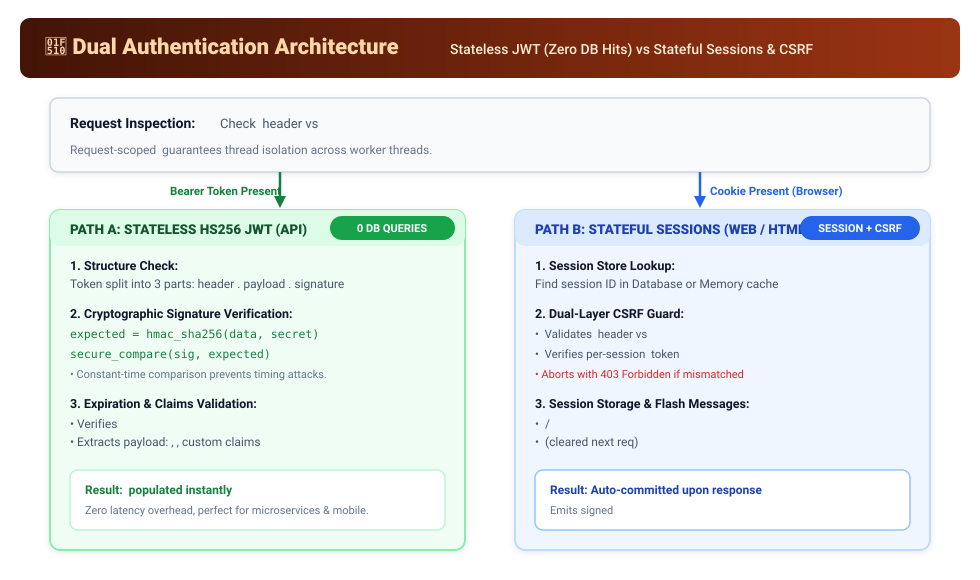

# Spid3rWeb — Architectural Diagrams 🎨

This directory contains visual architecture diagrams and technical schematics for the **Spid3rWeb MVC Framework**. Each diagram is available as an optimized, standalone vector SVG (`.svg`) and as editable Mermaid source code (`.mmd`).

---

## Diagram Index

| Diagram | SVG File | Mermaid Source | Description |
|---|---|---|---|
| **1. Architecture Overview** | [architecture-overview.svg](architecture-overview.svg) | [architecture-overview.mmd](architecture-overview.mmd) | 3-tier separation: Spid3r Rust Runtime, Spid3rWeb Framework Core, and User Application layer. |
| **2. Request Lifecycle** | [request-lifecycle.svg](request-lifecycle.svg) | [request-lifecycle.mmd](request-lifecycle.mmd) | Complete 9-step request execution from TCP socket to HTTP response. |
| **3. True Onion Middleware** | [onion-middleware.svg](onion-middleware.svg) | [onion-middleware.mmd](onion-middleware.mmd) | Inbound and outbound dual-pass middleware wrapping with `(req, next) => next(req)`. |
| **4. O(1) & Prefix Router** | [router-architecture.svg](router-architecture.svg) | [router-architecture.mmd](router-architecture.mmd) | 133k ops/sec routing pipeline: static hash map, 2-level prefix buckets, and wildcards. |
| **5. MVC & Zero-Boilerplate ORM** | [mvc-orm-flow.svg](mvc-orm-flow.svg) | [mvc-orm-flow.mmd](mvc-orm-flow.mmd) | Models, auto-casts, QueryBuilder, mutex-serialized transactions, and native DB drivers. |
| **6. Dual Authentication** | [auth-flow.svg](auth-flow.svg) | [auth-flow.mmd](auth-flow.mmd) | Stateless HS256 JWT (0 DB queries) vs Stateful Session Cookies and 2-layer CSRF protection. |

---

## 1. Architecture Overview
Shows how user application code (`app/`) interacts with the Spid3rWeb framework core (`framework/`) and the underlying Spid3r native Rust runtime binary.

---

## 2. Request Lifecycle
Details every step of `Application.handle_request(raw_req)`:

---

## 3. True Onion Middleware
Visualizes how the `Pipeline` wraps each middleware layer around downstream handlers so logic can execute before and after the route handler:

---

## 4. O(1) & Prefix-Indexed Router
Shows the multi-stage router lookup algorithm that achieves **133,333 ops/sec** on the bytecode VM:

---

## 5. MVC & Zero-Boilerplate ORM Flow
Illustrates model definitions, automatic type casting, dirty tracking, QueryBuilder compilation, and native database driver integration:

---

## 6. Dual Authentication Flow
Contrasts zero-database-hit stateless JWT Bearer token authentication with stateful session cookies and CSRF protection:

